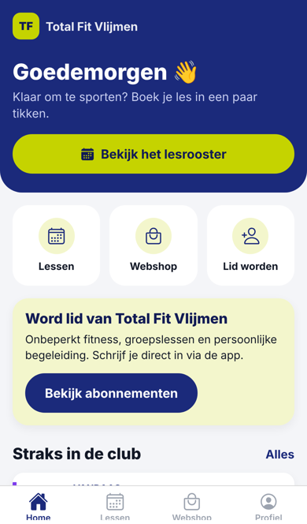
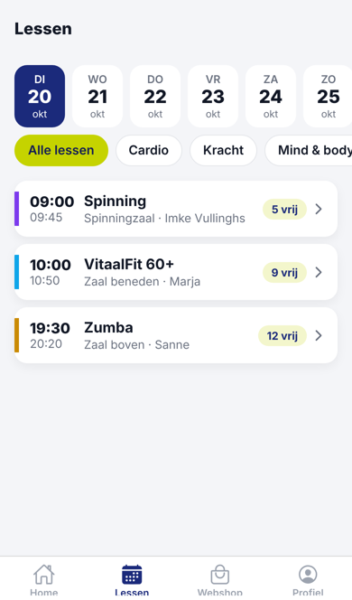
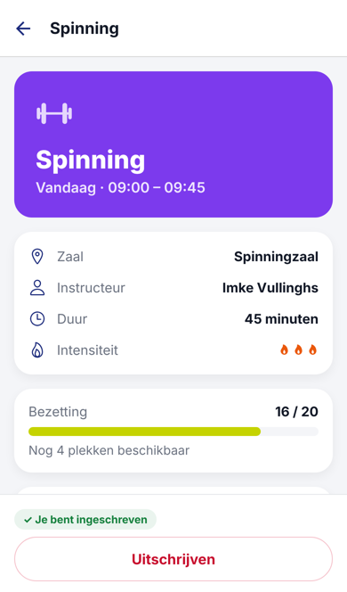
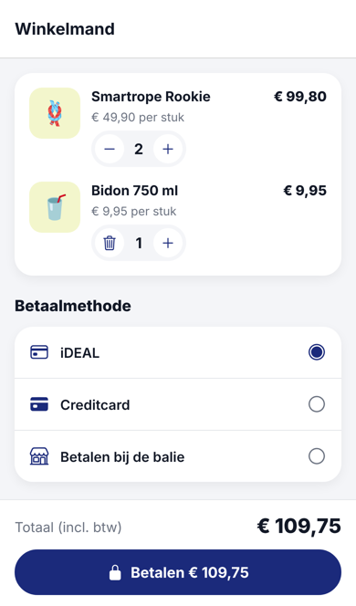
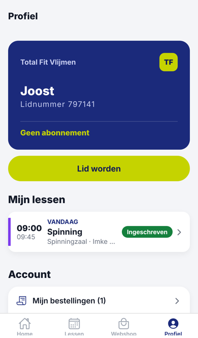

# Total Fit Vlijmen – app

Nieuwe app voor iPhone (en straks Android) voor Total Fit Vlijmen, gebouwd met
[Expo](https://expo.dev) / React Native. Eén codebase voor iOS én Android.

## Wat zit erin

<p>
     
</p>

| Onderdeel | Wat kan het |
|---|---|
| **Home** | Begroeting, je eerstvolgende les, snelle acties, lessen van vandaag |
| **Lessen** | Rooster voor 14 dagen, filter op type, inschrijven, uitschrijven (tot 2 uur vooraf), wachtlijst bij volle lessen |
| **Webshop** | Producten met correcte prijzen, winkelmand met juiste totalen, betaalmethode kiezen, bestelhistorie |
| **Lid worden** | Abonnement kiezen, gegevens + IBAN invullen, overzicht eerste betaling |
| **Inchecken** | QR-code met lidnummer om bij de ingang te scannen, met lopende klok (geen screenshot) |
| **Profiel** | Digitale ledenpas, mijn lessen, wachtlijst, bestellingen, uitloggen, account verwijderen |

Bedragen worden overal in hele centen opgeslagen (`src/lib/format.ts`), dus de
afrondingsfouten van de oude webshop (€ 0,00 per stuk, maar € 49,90 totaal) kunnen niet meer optreden.

## Belangrijk: dit is nu nog een demo-versie

De app werkt volledig, maar de gegevens zijn **voorbeelddata** en worden alleen op de telefoon zelf bewaard:

- **Lessen, prijzen, abonnementen** staan in `src/data/catalog.ts`. Pas ze daar aan.
- **Inloggen** accepteert elk e-mailadres met een wachtwoord van 6+ tekens.
- **Betalen** wordt gesimuleerd.
- **QR-code inchecken** bevat nu alleen het lidnummer. Welk formaat de scanner bij de ingang verwacht hangt af van het toegangssysteem; dat moet nog afgestemd worden (zie `getCheckInCode` in `src/data/api.ts`).

Om de app echt te gebruiken is een **backend** nodig (de plek waar leden, boekingen en
bestellingen centraal staan). Opties:

1. **Koppelen aan het huidige ledensysteem (OpenControlPlus)** – vraag de leverancier of er een API is. Dan blijft de balie gewoon met hetzelfde systeem werken.
2. **Eigen backend**, bijvoorbeeld met Supabase of Firebase (inloggen + database), en
   **Mollie** voor iDEAL-betalingen en automatische incasso.

Alle data loopt via `src/data/api.ts` en `src/store/AppStore.tsx`; daar komt de koppeling, de schermen hoeven niet te veranderen.

## Zelf uitproberen op je iPhone (zonder Mac)

1. Installeer [Node.js](https://nodejs.org) (LTS) op je computer.
2. Installeer de app **Expo Go** uit de App Store op je iPhone.
3. In deze map:
   ```bash
   npm install
   npx expo start
   ```
4. Scan de QR-code met de camera van je iPhone. De app opent in Expo Go.

> Let op: Expo Go ondersteunt alleen de nieuwste Expo-versie. Werkt het niet, gebruik dan een
> *development build*: `npx eas-cli@latest build --profile development --platform ios`.

## Publiceren in de App Store

Je hebt **geen Mac nodig**; Expo bouwt de app in de cloud (EAS).

### 1. Accounts aanmaken
- **Apple Developer Program**: <https://developer.apple.com/programs/> – €99 per jaar.
  Tip: schrijf je in als **organisatie** (op naam van de sportschool, met KvK- en D-U-N-S-nummer).
  Dan staat "Total Fit Vlijmen" als verkoper in de App Store in plaats van je eigen naam.
  Publiceer je niet zelf namens de sportschool, regel dan eerst toestemming van de eigenaar
  (naam en logo zijn van hen).
- **Expo-account** (gratis): <https://expo.dev/signup>

### 2. Klaarmaken
- Vervang `assets/icon.png` (1024×1024, geen transparantie) en `assets/splash-icon.png` door het echte logo.
- Controleer in `app.json` de `bundleIdentifier` (`nl.totalfitvlijmen.app`).
- Zorg voor een **privacyverklaring** op een website (verplicht, de app verwerkt persoonsgegevens).

### 3. Bouwen en uploaden
```bash
npm install -g eas-cli
eas login
eas build:configure        # eenmalig, koppelt het project aan je Expo-account
eas build --platform ios   # bouwt de app in de cloud; EAS regelt de certificaten
eas submit --platform ios  # uploadt naar App Store Connect
```

### 4. Testen met TestFlight
In [App Store Connect](https://appstoreconnect.apple.com) verschijnt de build onder **TestFlight**.
Nodig jezelf en een paar leden uit om te testen voordat je live gaat.

### 5. Indienen voor review
Vul in App Store Connect in: beschrijving, screenshots (6,9" iPhone), categorie *Gezondheid en fitness*,
privacy-URL, en privacylabels (welke gegevens je verzamelt). Geef Apple een **demo-account** zodat
de reviewer kan inloggen. Review duurt meestal 1–3 dagen.

**Apple-regels om op te letten:**
- Accounts aanmaken in de app ⇒ ook account **verwijderen** in de app (zit erin: Profiel → Account verwijderen).
- Abonnementen voor de fysieke sportschool en fysieke producten mogen via iDEAL/Mollie betaald worden
  (géén Apple In-App Purchase nodig). Verkoop je later **online video-lessen**, dan moet dat wél via Apple In-App Purchase.

### Updates
Kleine wijzigingen (teksten, schermen) kun je zonder nieuwe review direct naar gebruikers sturen:
```bash
eas update --branch production
```

## Android
Dezelfde code werkt op Android: `eas build --platform android` en `eas submit --platform android`
(Google Play Developer-account, eenmalig $25).

## Voor ontwikkelaars
```bash
npm run typecheck   # TypeScript controle
npx expo start      # dev server (i = iOS simulator, w = web)
```
Structuur: schermen in `src/app/` (Expo Router), componenten in `src/components/`,
data in `src/data/`, app-status in `src/store/`.
